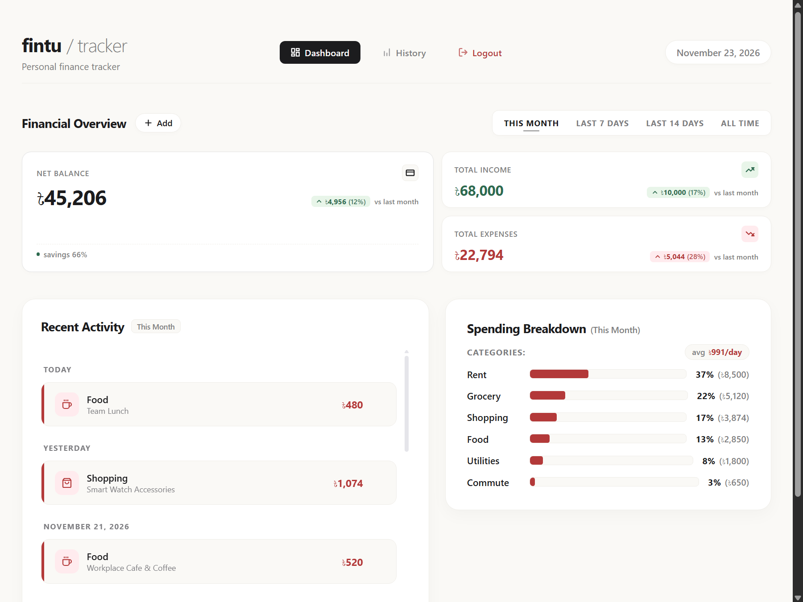
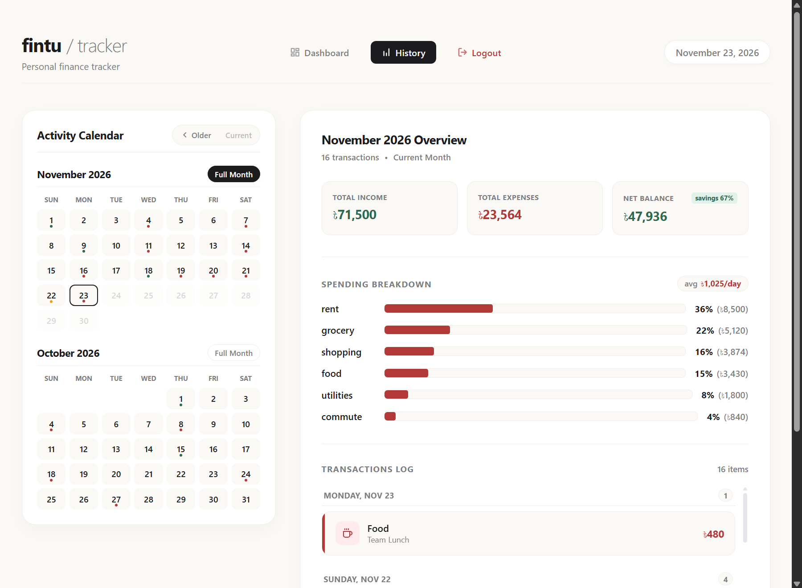
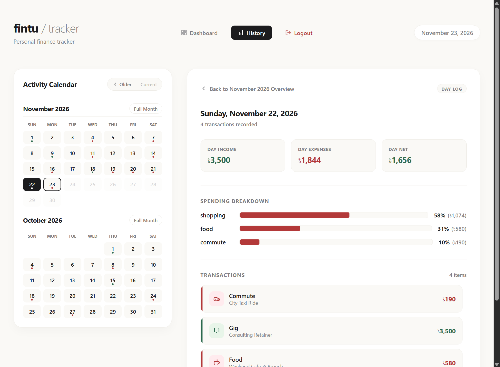

<p align="center">
  <br>
  <h1 align="center">fintu</h1>
  <p align="center">
    <strong>A fast, distraction-free personal finance tracker built to load instantly and look clean.</strong>
  </p>
  <p align="center">
    Zero heavy JavaScript frameworks • Zero tracking • Zero ads • 100% Privacy
  </p>
  <p align="center">
    
    
    
    
    
    
  </p>
  <br>
</p>

<!-- Dashboard Overview -->
<p align="center">
  
</p>

---

## ✨ Overview

**fintu** is an ultra-lean personal finance manager created for people who want instant financial clarity without the bloat, battery drain, or privacy compromises of modern multi-megabyte SPAs.

Powered by **FastAPI** on the backend and **HTMX** for seamless, single-page DOM transitions, **fintu** renders server-side in milliseconds while delivering a reactive, app-like user experience styled with bespoke, minimalist **Vanilla CSS**.

---

## 🚀 Key Features

### 📊 Financial Command Center
- **Executive Hero Card**: Real-time summary showing **Total Balance**, **Monthly Income**, **Monthly Expenses**, and an automated **Savings Rate** percentage.
- **Whole-Number Formatting**: Currency values formatted cleanly without distracting decimals (`৳45,100`).
- **Quick-Add Transaction Modal**: High-velocity modal with keyboard-friendly inputs, instant income/expense toggle, and date picking.

### 📅 Interactive Activity Calendar & Monthly Overview
- **Heatmap-Style Activity Dots**: Date cells color-coded to visualize daily activity at a glance:
  - 🟢 **Green**: Income received
  - 🔴 **Red**: Expenses recorded
  - 🟡 **Amber**: Both income and expense on the same day
- **Single-Month Mobile Accordion**: On mobile devices, the calendar collapses into a compact ~46px bar so monthly numbers and KPIs are immediately accessible above the fold.
- **Intuitive Month Stepper**: Browse historical records month-by-month (`‹ November 2026 ›`) with instant DOM updates and full-month overview toggles.

<!-- Feature Showcase: Activity Calendar & Full Month Overview -->
<p align="center">
  
</p>

### 📈 Category Breakdown & Single-Day Deep Dive
- **Instant Single-Day Drilldown**: Click any active date in the calendar to immediately inspect daily net balance, categorized spend distribution, and itemized receipts without leaving the page.
- **Visual Distribution Bars**: Categorized spend tracking with percentage breakdown and proportional progress bars.
- **Daily Average Spent Metric**: Real-time daily burn rate metric (`avg ৳.../day`) highlighted in expense-red font across both desktop and mobile viewports.
- **Tactile Transaction Log**: Color-coded transaction cards with contextual category iconography and timestamping.

<!-- Feature Showcase: Single-Day Breakdown -->
<p align="center">
  
</p>

### 📱 Responsive By Design
- Seamlessly transitions from high-resolution multi-column desktop displays (`1120px` grid) down to narrow mobile viewports (`320px`+).
- Horizontal scrollable filter pills, touch-friendly tap targets, and automated scroll-to-breakdown transitions.

### 🔌 Universal Database Engine
- **Zero-Config SQLite**: Local development out of the box using `finance.db`.
- **Production PostgreSQL Ready**: Auto-detects cloud `DATABASE_URL` connections (Supabase, Neon, Render) with dialect fallbacks (`postgresql+psycopg://` / `postgresql://`).

---

## 🛠️ Tech Stack

| Layer | Technology | Purpose |
| :--- | :--- | :--- |
| **Backend** | [FastAPI](https://fastapi.tiangolo.com/) | High-performance asynchronous Python API & routing |
| **Interactivity** | [HTMX 1.9](https://htmx.org/) | Reactive AJAX DOM replacements without JavaScript frameworks |
| **Templating** | [Jinja2](https://jinja.palletsprojects.com/) | Fast, server-side template rendering |
| **Styling** | **Vanilla CSS3** | Pearl-white aesthetic, CSS design tokens, zero external CSS bloat |
| **Database** | [SQLAlchemy 2.0](https://www.sqlalchemy.org/) | ORM with dual SQLite & PostgreSQL compatibility |
| **Runtime** | Python 3.10+ | Lightweight, portable backend execution |

---

## 🏁 Quick Start

### 1. Clone & Set Up
```bash
git clone https://github.com/MahirTB/fintu.git
cd fintu
python -m venv .venv
```

### 2. Activate Environment
- **Windows (PowerShell):**
  ```powershell
  .venv\Scripts\Activate.ps1
  ```
- **macOS / Linux:**
  ```bash
  source .venv/bin/activate
  ```

### 3. Install Dependencies
```bash
pip install -r requirements.txt
```

### 4. Run the Development Server
```bash
uvicorn main:app --reload
```
Navigate to `http://127.0.0.1:8000`. The local database initializes automatically on your first visit!

---

## ☁️ Deployment

### Vercel (Serverless Python)
The repository includes a ready-to-deploy [`vercel.json`](vercel.json) configuration:
```bash
vercel
```

### Render + Supabase (PostgreSQL)
1. Deploy as a Web Service on **Render**.
2. Set the environment variable `DATABASE_URL` to your **Supabase** or **Neon** PostgreSQL connection string.

### Fly.io (Persistent SQLite)
1. Launch with `fly launch`.
2. Attach a free 1GB persistent volume to `/data` to persist `finance.db`.

---

## 📄 License

Distributed under the [MIT License](LICENSE). Built with ❤️ for clean, focused personal finance management.
